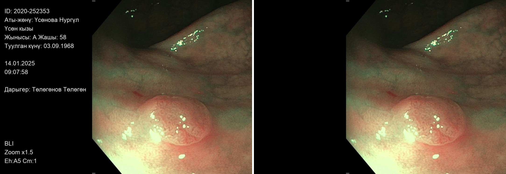
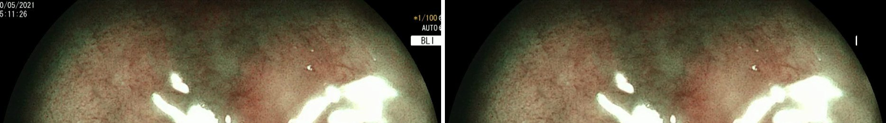

# 01 · Erase burned-in patient data from endoscopy video, on the fly

Endoscopy processors write the patient's name, date of birth, ID, the physician, the date and the time straight into
the video pixels. This prototype finds every burned-in word with **Ultralytics YOLO26-Text** and blacks it out,
frame by frame, with **NVIDIA TensorRT FP16** on one RTX 5060 Ti.

Research prototype, not certified de-identification. The test overlays are synthetic and every name in them is fictitious.





Logs of every number below are in [`results/`](results/).

## Results

Synthetic test set: 1,080 frames of REAL-Colon colonoscopy video, 22,440 burned-in words in English, Russian and Kyrgyz
(ө ү ң), 8 fonts, 3 sizes, 3 layouts (side column, corners, over the image), blur and JPEG. A word counts as erased when at
least 98 % of its glyph pixels are under the mask. Threshold 0.05, rectangle grown by the word height sideways and a
quarter of it up and down.

| Detector (TensorRT FP16, 1280 px) | Words erased | ms per frame | Picture hidden by mistake |
|---|---|---|---|
| yolo26n-text | 99.86 % | 5.4 | 0.275 % |
| **yolo26s-text** | **99.88 %** | **7.1** | **0.090 %** |
| yolo26m-text | 99.88 % | 10.9 | 0.091 % |

PyTorch on Apple M1 (MPS) gives 99.89 % for yolo26s-text: the FP16 engine keeps the accuracy.

**Memory.** Burned-in text does not move, so a pixel that was text in a third of the last 30 frames stays erased.
On 4,860 consecutive synthetic frames (135 procedures × 36 frames), frames with a missed name word drop from 30 to 0
and words erased rise from 99.82 % to 99.97 %. The frames of one procedure are not independent: this is not a
guarantee.

**Real overlay.** One REAL-Colon clip (002-008, 1,498 frames, 930×720) still carries the processor's own date, time and
settings. Without hand labels, the ground truth is everything bright outside the endoscope's circle (and the dark letters
on a white mode plate).
- Date and time: erased in 1,498 of 1,498 frames, with and without memory.
- Settings ("*1/100", "Lv+5 AUTO", "BLI"): fully erased in 68 % of frames without memory and 84 % with it. What survives
  is the lone "*" before "1/100", the same punctuation the synthetic test shows.
- Full pipeline (OpenCV decode → detector → mask → encode): 0.4 + 8.9 + 3.0 ms, about 80 fps.
- A false box sometimes flickers on tissue: 0.06 % of the picture on average.

## How it works

1. `eraser.py`: `Eraser` = YOLO26-Text (oriented word boxes) → rectangles grown by each word's height → 30-frame memory.
2. `overlay.py` + `make_set.py`: the synthetic overlays (fonts are taken from macOS and are not redistributed).
3. `eval.py`, `eval_video.py`, `eval_real.py`: the three tests above. `report.py` lists the misses.
4. TensorRT: `YOLO("yolo26s-text.pt").export(format="engine", half=True, imgsz=1280)` with Ultralytics 8.4.212,
   TensorRT 11.4 and nvidia-modelopt 0.47 (FP16 comes from ModelOpt autocast; without it the export fails).

```bash
python make_set.py clips/ out/set 8
python eval.py out/set yolo26s-text.engine 0 1280
python eval_real.py clips/c5_rectum.mp4 yolo26s-text.engine 0
```

## Credits and licence

- Video: REAL-Colon (Biffi et al., Scientific Data 2024), CC BY 4.0.
- Detector: Ultralytics YOLO26-Text, AGPL-3.0. This code imports Ultralytics and is released under AGPL-3.0 too.
- NVIDIA TensorRT, NVIDIA Model Optimizer.

Zalkarbek Arapbaev, physician and computer vision engineer.
